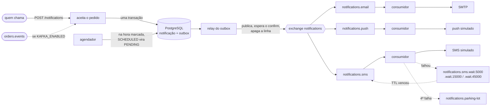

# notification-service

[](https://github.com/Jhonatas-de-Freitas/notification-service/actions/workflows/ci.yml)

Serviço de notificações por e-mail, SMS e push. Quem pede a notificação não espera a entrega: o serviço aceita, grava, põe na fila e entrega depois, tentando de novo quando o canal falha. Também agenda para mais tarde.

Faz parte de uma loja fictícia que montei em cinco repositórios, mas roda sozinho. Java 21, Spring Boot 4.1, RabbitMQ, PostgreSQL e, opcional, Kafka.

## Como funciona



O desenho mostra as filas de espera só do SMS, mas e-mail e push têm as suas, iguais.

1. O `POST /notifications` cria uma notificação para cada canal e responde `202`. Sem `channels`, valem os canais ligados na preferência do usuário. Canal desligado, ou sem endereço (SMS sem telefone), fica registrado como `SKIPPED`, com o motivo.
2. Na mesma transação vai uma linha na tabela `outbox`. Um relay lê essa tabela, publica no RabbitMQ e só apaga a linha depois que o broker confirma.
3. Cada canal tem a sua fila e os seus consumidores. O consumidor chama o provedor e grava a tentativa.
4. Se o provedor falha, a notificação fica `RETRYING` e a mensagem vai para uma fila de espera sem consumidor. Quando o TTL da fila vence, o próprio RabbitMQ devolve a mensagem para a fila do canal. Os intervalos são 5 s, 15 s e 45 s.
5. Na quarta falha a notificação fica `FAILED` e a mensagem vai para a fila de erros.
6. Com `scheduledAt` no futuro a notificação fica `SCHEDULED` e não entra na fila. Um agendador confere a cada segundo o que já venceu e põe na fila.
7. Com `KAFKA_ENABLED=true` o serviço também ouve o tópico `orders.events`. `OrderCreated`, `OrderConfirmed` e `OrderCancelled` viram um pedido de e-mail e push para o cliente, e daí em diante seguem o mesmo caminho.

O e-mail sai de verdade por SMTP, para o [Mailpit](https://mailpit.axllent.org/) (uma caixa de entrada falsa com tela web). SMS e push são simulados dentro do serviço, com regras para provocar falha:

| Canal | Sempre falha | Falha 2 vezes e depois funciona |
|---|---|---|
| SMS | telefone terminado em `0000` | telefone terminado em `0001` |
| Push | `deviceToken` começando com `fail-` | `deviceToken` começando com `flaky-` |
| E-mail | endereço `@falha.exemplo` | |

## Como rodar

Precisa só de Docker.

```bash
docker compose up -d --build --wait
```

| O quê | Onde |
|---|---|
| API | http://localhost:8084 |
| Swagger | http://localhost:8084/swagger-ui.html |
| Caixa de entrada (Mailpit) | http://localhost:8025 |
| Painel do RabbitMQ | http://localhost:15672 (`guest` / `guest`) |
| Métricas | http://localhost:8084/actuator/prometheus |

As métricas do serviço: `notifications_deliveries_total` (por canal e resultado: `sent`, `retry`, `failed`, `duplicate`), `notifications_delivery_time_seconds` (do momento em que devia sair até a entrega) e `notifications_parking_lot_messages` (tamanho da fila de erros).

Para ver as tentativas mais rápido ou mais devagar: `NOTIFICATIONS_RETRY_INTERVALS=1s,2s,3s docker compose up -d`.

Testes: `./mvnw verify`. Os de integração sobem PostgreSQL, RabbitMQ, Kafka e Mailpit com Testcontainers.

## Como testar os cenários

O `scripts/smoke-test.sh` roda todos os cenários abaixo e confere as respostas (precisa de `curl` e `jq`; leva pouco mais de um minuto). É o que o CI executa. Um por um:

**E-mail.** Depois do `POST`, abra http://localhost:8025 e o e-mail está lá.

```bash
curl -s -X POST http://localhost:8084/notifications \
  -H 'Content-Type: application/json' \
  -H 'Idempotency-Key: cupom-1' \
  -d '{"userId":"c-1001","recipient":{"name":"Ana Souza","email":"ana@exemplo.com"},
       "channels":["EMAIL"],"template":"GENERIC",
       "params":{"title":"Cupom de sexta","message":"Seu cupom chegou."}}'
```

A resposta traz o `id` de cada notificação. Para acompanhar uma delas, com as tentativas, e para ver a caixa de entrada sem abrir a tela:

```bash
curl -s http://localhost:8084/notifications/<id>
curl -s 'http://localhost:8025/api/v1/search?query=to:ana@exemplo.com'
```

**Mesma chave duas vezes.** Repita o `POST` acima: a resposta traz o mesmo `requestId` e o mesmo `id`, e nenhum e-mail novo chega.

**Preferências.** Quem nunca configurou recebe e-mail e push, e não recebe SMS. Um pedido de SMS para essa pessoa volta `SKIPPED`. Para ligar o SMS, o que vale a partir do próximo pedido:

```bash
curl -s -X PUT http://localhost:8084/preferences/c-1001 \
  -H 'Content-Type: application/json' \
  -d '{"email":true,"sms":true,"push":true}'
```

**SMS que falha duas vezes e depois vai.** Fica `RETRYING` e, depois das esperas de 5 s e 15 s, `SENT` com três tentativas.

```bash
curl -s -X POST http://localhost:8084/notifications \
  -H 'Content-Type: application/json' \
  -d '{"userId":"c-1001","recipient":{"name":"Ana Souza","phone":"+5511999990001"},
       "channels":["SMS"],"template":"GENERIC",
       "params":{"title":"Cupom de sexta","message":"Seu cupom chegou."}}'
```

**SMS que nunca vai.** Troque o telefone por `+5511999990000`. Depois de quatro tentativas (5 s + 15 s + 45 s de espera) fica `FAILED` e a mensagem aparece na fila `notifications.parking-lot`, no painel do RabbitMQ.

**Agendada.** Responde `SCHEDULED`, nada sai antes da hora e, dez segundos depois, está `SENT`. (No macOS, troque `-d '+10 seconds'` por `-v+10S`.)

```bash
curl -s -X POST http://localhost:8084/notifications \
  -H 'Content-Type: application/json' \
  -d '{"userId":"c-1001","recipient":{"name":"Ana Souza","email":"ana@exemplo.com"},
       "channels":["EMAIL"],"template":"GENERIC",
       "params":{"title":"Lembrete","message":"Seu carrinho continua aqui."},
       "scheduledAt":"'"$(date -u -d '+10 seconds' +%Y-%m-%dT%H:%M:%SZ)"'"}'
```

**Listar.** Com filtro por usuário, pedido e estado:

```bash
curl -s 'http://localhost:8084/notifications?userId=c-1001&status=SENT&page=0&size=20'
```

**Evento de pedido pelo Kafka.** Um segundo arquivo de compose acrescenta o Kafka e liga o adaptador:

```bash
docker compose -f docker-compose.yml -f docker-compose.kafka.yml up -d --build --wait

echo '{"eventId":"0b9d6c1e-4a7b-4f0e-9a51-0c6f3d2a8e11","type":"OrderConfirmed","orderId":"7c1f0a34-5b1d-4f6e-8a2b-9d3e4f5a6b7c","occurredAt":"2026-10-10T14:03:22Z","payload":{"customerId":"c-1001","customerName":"Ana Souza","customerEmail":"ana@exemplo.com","totalAmount":699.80,"items":[{"productId":"11111111-1111-1111-1111-111111111111","productName":"Teclado","quantity":2,"unitPrice":349.90}]}}' \
  | docker compose -f docker-compose.yml -f docker-compose.kafka.yml exec -T kafka \
      /opt/kafka/bin/kafka-console-producer.sh --bootstrap-server kafka:9092 --topic orders.events
```

Chega o e-mail "Seu pedido #7C1F0A34 foi confirmado", com os itens e o total. Publicar a mesma linha de novo não gera outro, porque o `eventId` é o mesmo. O `scripts/smoke-test-kafka.sh` faz isso e confere.

## Decisões que tomei e por quê

**Uma fila por canal.** Cada fila tem os seus consumidores e as suas threads. Se o provedor de SMS ficar lento ou parar, as mensagens de SMS se acumulam na fila do SMS, e e-mail e push continuam saindo. Com uma fila só, a mensagem lenta ficaria na frente de todas. O teste `ChannelIsolationIT` para os consumidores do SMS e confere que os outros dois canais entregam.

**Retry por TTL e dead-letter, sem `Thread.sleep`.** A mensagem que falhou vai para uma fila sem consumidor que tem TTL e, como destino de dead-letter, a fila do canal. Quem conta o tempo é o broker: nenhuma thread fica presa esperando e a espera sobrevive a uma queda do serviço. É uma fila por intervalo, com o TTL na fila, porque o RabbitMQ só expira a mensagem que está na frente: com TTL por mensagem, uma espera de 5 s ficaria atrás de uma de 45 s. O TTL faz parte do nome (`.wait.5000`) porque o broker não deixa redeclarar uma fila com argumentos diferentes.

**Outbox em vez de publicar direto.** Se eu gravasse no banco e publicasse em seguida, uma queda entre os dois passos deixaria uma notificação gravada que ninguém entrega. Com a linha do outbox na mesma transação, ou existem as duas coisas ou nenhuma. O custo é que a mesma mensagem pode ser publicada duas vezes.

**Como evita envio em dobro.** São três pontos, um para cada jeito de a repetição acontecer:
- Pedido repetido: o `Idempotency-Key` (ou `event:<eventId>`, vindo do Kafka) tem índice único no banco. A segunda chamada devolve o que a primeira criou, mesmo quando as duas chegam juntas.
- Mensagem repetida: o consumidor faz `SELECT ... FOR UPDATE` na notificação antes de chamar o provedor e só envia se aquela for a próxima tentativa esperada. Uma cópia espera na trava e, quando entra, vê a tentativa já registrada e não faz nada (`DuplicateDeliveryIT`).
- O que isso não resolve: se o serviço cair depois de o provedor aceitar e antes do commit, a tentativa é refeita. Entrega exatamente uma vez dependeria de o provedor aceitar uma chave de idempotência.

**Como o agendador aguenta duas instâncias.** Todas as instâncias rodam o agendador, sem eleição de líder. Ele busca as vencidas com `FOR UPDATE SKIP LOCKED` e, na mesma transação, muda o estado para `PENDING` e grava a linha do outbox. A linha que uma instância pegou fica travada: a outra pula e leva as seguintes, sem esperar. Depois do commit a linha não é mais `SCHEDULED` e ninguém a encontra de novo. O `SchedulerConcurrencyIT` confere as duas coisas: com uma transação segurando três linhas, a segunda leva só as outras; e com três agendadores disputando 40 notificações, a fila recebe 40 mensagens, uma de cada.

**Falha do provedor não é exceção no consumidor.** Ela vira uma tentativa registrada e uma nova espera. Exceção no consumidor é outra coisa (mensagem malformada, banco fora): a mensagem é rejeitada sem voltar para a fila e o RabbitMQ a manda para a fila de erros, em vez de ficar em laço.

**O texto é montado na hora do pedido.** Assunto e corpo ficam gravados na notificação, então um parâmetro inválido volta como `400` na hora e todas as tentativas enviam o mesmo conteúdo.

**O Kafka é só mais uma entrada.** O adaptador traduz o evento e chama o mesmo serviço que a API chama, então idempotência, preferências e retry valem igual. Tipo de evento desconhecido é ignorado. Mensagem que não dá para ler vai para o tópico `notification-service.dlt` e a partição segue em frente. Fica desligado por padrão para o serviço rodar sem Kafka.

## O que eu faria a seguir

- Um endpoint para reenviar o que está na fila de erros.
- Cancelar uma notificação agendada antes da hora.
- Avisar o relay logo depois do commit, para não esperar a próxima leitura do outbox (hoje, até 1 s).
- Guardar um resumo do corpo junto com o `Idempotency-Key`, para recusar a mesma chave com um pedido diferente.
- Horário de silêncio e limite de mensagens por usuário, que são as primeiras coisas que um sistema desses pede em produção.
