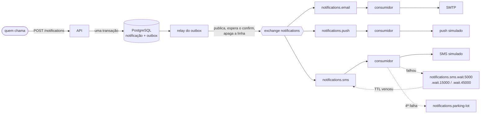

# notification-service

[](https://github.com/Jhonatas-de-Freitas/notification-service/actions/workflows/ci.yml)

Serviço de notificações por e-mail, SMS e push. Quem pede a notificação não espera a entrega: o serviço aceita, grava, põe na fila e entrega depois, tentando de novo quando o canal falha.

Faz parte de uma loja fictícia que estou montando em cinco repositórios, mas roda sozinho.

> Em construção. Já funciona: API, filas, entrega, novas tentativas, fila de erros e preferências. Falta o agendamento (um pedido com `scheduledAt` no futuro fica `SCHEDULED` e ainda não é enviado) e o adaptador que ouve os eventos de pedido no Kafka.

## Como funciona



1. O `POST /notifications` cria uma notificação para cada canal e responde `202`. Canal desligado na preferência do usuário, ou sem endereço (SMS sem telefone), fica registrado como `SKIPPED`, com o motivo.
2. Na mesma transação vai uma linha na tabela `outbox`. Um relay lê essa tabela, publica no RabbitMQ e só apaga a linha depois que o broker confirma.
3. Cada canal tem a sua fila e os seus consumidores. O consumidor chama o provedor e grava a tentativa.
4. Se o provedor falha, a notificação fica `RETRYING` e a mensagem vai para uma fila de espera sem consumidor. Quando o TTL da fila vence, o próprio RabbitMQ devolve a mensagem para a fila do canal. Os intervalos são 5 s, 15 s e 45 s.
5. Na quarta falha a notificação fica `FAILED` e a mensagem vai para a fila de erros.

O e-mail sai de verdade por SMTP, para o [Mailpit](https://mailpit.axllent.org/) (uma caixa de entrada falsa com tela web). SMS e push são simulados dentro do serviço, com regras para provocar falha:

| Canal | Sempre falha | Falha 2 vezes e depois funciona |
|---|---|---|
| SMS | telefone terminado em `0000` | telefone terminado em `0001` |
| Push | `deviceToken` começando com `fail-` | `deviceToken` começando com `flaky-` |
| E-mail | endereço `@falha.exemplo` | |

## Como rodar

Precisa só de Docker.

```bash
docker compose up -d --build --wait
```

| O quê | Onde |
|---|---|
| API | http://localhost:8084 |
| Swagger | http://localhost:8084/swagger-ui.html |
| Caixa de entrada (Mailpit) | http://localhost:8025 |
| Painel do RabbitMQ | http://localhost:15672 (`guest` / `guest`) |
| Métricas | http://localhost:8084/actuator/prometheus |

Os intervalos entre as tentativas mudam pela variável `NOTIFICATIONS_RETRY_INTERVALS` (padrão `5s,15s,45s`).

Para rodar os testes: `./mvnw verify` (os de integração sobem PostgreSQL, RabbitMQ e Mailpit com Testcontainers).

## Como testar os cenários

**E-mail.** Depois do `POST`, abra http://localhost:8025 e o e-mail está lá.

```bash
curl -s -X POST http://localhost:8084/notifications \
  -H 'Content-Type: application/json' \
  -H 'Idempotency-Key: cupom-1' \
  -d '{"userId":"c-1001","recipient":{"name":"Ana Souza","email":"ana@exemplo.com"},
       "channels":["EMAIL"],"template":"GENERIC",
       "params":{"title":"Cupom de sexta","message":"Seu cupom chegou."}}'
```

A resposta traz o `id` de cada notificação. Para acompanhar uma delas, com as tentativas:

```bash
curl -s http://localhost:8084/notifications/<id>
```

Repetindo o `POST` com o mesmo `Idempotency-Key`, a resposta é a mesma e nada novo é criado.

**Preferências.** Quem nunca configurou recebe e-mail e push, e não recebe SMS. Para ligar o SMS:

```bash
curl -s -X PUT http://localhost:8084/preferences/c-1001 \
  -H 'Content-Type: application/json' \
  -d '{"email":true,"sms":true,"push":true}'
```

**SMS que falha duas vezes e depois vai.** Fica `RETRYING` e, uns 20 segundos depois, `SENT` com três tentativas.

```bash
curl -s -X POST http://localhost:8084/notifications \
  -H 'Content-Type: application/json' \
  -d '{"userId":"c-1001","recipient":{"name":"Ana Souza","phone":"+5511999990001"},
       "channels":["SMS"],"template":"GENERIC",
       "params":{"title":"Cupom de sexta","message":"Seu cupom chegou."}}'
```

**SMS que nunca vai.** Troque o telefone por `+5511999990000`. Depois de quatro tentativas (pouco mais de um minuto) fica `FAILED` e a mensagem aparece na fila `notifications.parking-lot`, no painel do RabbitMQ.

**Listar.** Com filtro por usuário, pedido e estado:

```bash
curl -s 'http://localhost:8084/notifications?userId=c-1001&status=SENT&page=0&size=20'
```

## Decisões que tomei e por quê

**Outbox em vez de publicar direto.** Se eu gravasse no banco e publicasse no RabbitMQ em seguida, uma queda entre os dois passos deixaria uma notificação gravada que ninguém entrega. Com a linha do outbox na mesma transação, ou existem as duas coisas ou nenhuma. O custo é que a mesma mensagem pode ser publicada duas vezes, e o consumidor precisa aguentar isso.

**Uma fila de espera por intervalo, com o TTL na fila.** O RabbitMQ só expira a mensagem que está na frente da fila. Com TTL por mensagem, uma espera de 5 s ficaria presa atrás de uma de 45 s. O TTL faz parte do nome da fila (`.wait.5000`) porque o broker não deixa redeclarar uma fila com argumentos diferentes: mudar o intervalo cria outra fila em vez de quebrar a subida.

**Linha travada durante o envio.** O consumidor faz `SELECT ... FOR UPDATE` na notificação antes de chamar o provedor. Uma cópia repetida da mensagem espera na trava e, quando entra, vê que aquela tentativa já foi registrada e não faz nada. Custa uma conexão do banco enquanto o provedor responde, por isso o SMTP tem timeout de 5 s. O que isso não resolve: se o serviço cair depois de o provedor aceitar e antes do commit, a tentativa é refeita. Entrega exatamente uma vez dependeria de o provedor aceitar uma chave de idempotência.

**A mensagem leva só o id e o número da tentativa.** O estado fica no banco. Os provedores simulados decidem pelo número da tentativa, então dão o mesmo resultado em qualquer instância.

**Falha do provedor não é exceção no consumidor.** Ela vira uma tentativa registrada e um novo agendamento. Exceção no consumidor é outra coisa (mensagem malformada, banco fora): a mensagem é rejeitada sem voltar para a fila e o RabbitMQ a manda para a fila de erros, em vez de ficar em laço.

**O texto é montado na hora do pedido.** Assunto e corpo ficam gravados na notificação, então um parâmetro inválido volta como `400` na hora e todas as tentativas enviam o mesmo conteúdo.

**Um container de consumo por canal.** Com o SMS parado, e-mail e push continuam saindo. Tem um teste para isso (`ChannelIsolationIT`).

## O que eu faria a seguir

- Terminar o agendamento e o adaptador do Kafka.
- Um endpoint para reenviar o que está na fila de erros.
- Avisar o relay logo depois do commit, para não esperar a próxima leitura do outbox (hoje, até 1 s).
- Guardar um resumo do corpo junto com o `Idempotency-Key`, para recusar a mesma chave com um pedido diferente.
